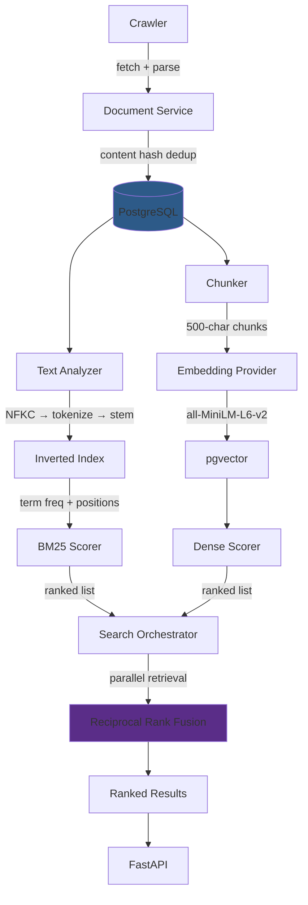

# NEXUS

Hybrid search engine combining custom BM25 lexical retrieval, 384-dimensional dense embeddings (pgvector), and Reciprocal Rank Fusion — built from first principles and evaluated empirically on the SciFact benchmark.

```
Web crawl → Document normalization → PostgreSQL
                                       ├── Inverted index → BM25
                                       └── Chunk embeddings → pgvector cosine
                                            └──────┬──────┘
                                              RRF fusion → Ranked results → API
```

## Benchmark reference (SciFact, 300-query test split)

| Retriever | NDCG@10 | Recall@100 | P95 Latency |
|---|---:|---:|---:|
| BM25 | 0.6736 | 0.9064 | 192.81 ms |
| Dense | 0.6642 | 0.9277 | 212.57 ms |
| Hybrid RRF | **0.7188** | **0.9577** | 313.14 ms |

*Reference results from a prior evaluation run against the canonical 300-query test split. The benchmark harness, dataset loader, and evaluation code are in [`scripts/benchmark/`](backend/scripts/benchmark/).*

---

## Technical snapshot

| Layer | Implementation |
|---|---|
| API | FastAPI (async) |
| Runtime | Python 3.12 |
| Database | PostgreSQL 16 |
| Vector search | pgvector (exact cosine scan) |
| Lexical search | Custom inverted index + BM25 (k1=1.5, b=0.75) |
| Dense retrieval | `all-MiniLM-L6-v2` — 384-dimensional, L2-normalized |
| Fusion | Reciprocal Rank Fusion (k=60) |
| Chunking | 500-char sliding window, 100-char overlap |
| Migrations | Alembic (5 migrations) |
| ORM | SQLAlchemy 2.0 (async) |
| Testing | pytest + pytest-asyncio (45 tests) |
| Static analysis | Ruff + mypy |

---

## Architecture



---

## Why I built this

Existing search abstractions (Elasticsearch wrappers, RAG frameworks, hosted vector databases) hide the retrieval decisions that determine search quality. NEXUS was built to understand and measure:

- How BM25 term scoring interacts with document length normalization
- Where lexical retrieval fails and dense retrieval compensates (and vice versa)
- Whether hybrid fusion actually improves ranking, and at what latency cost
- Whether learned routing or reranking can improve the quality/latency frontier
- How retrieval failure modes manifest in benchmark evaluation

---

## What makes NEXUS interesting

### First-principles retrieval
Custom inverted index with positional posting lists and BM25 scoring — not delegated to Elasticsearch or a hosted search service. The text analyzer, tokenizer, stemmer, stopword filter, and scorer are all in the repository and independently testable.

### Hybrid retrieval with measured evidence
Independent lexical (BM25) and dense (sentence-transformers + pgvector) branches fused through Reciprocal Rank Fusion. The benchmark shows RRF improves NDCG@10 by +6.7% over BM25-only and +8.2% over Dense-only, at the cost of ~100ms additional latency.

### Empirical evaluation
Search quality measured using a reproducible benchmark against 5,183 SciFact documents and 300 test queries. Metrics include NDCG@k, Recall@k, Precision@k, MRR, and latency percentiles — all computed by code in the repository.

### Negative-result discipline
Three approaches were tested and rejected based on measured evidence: a learned query router (improved latency but degraded quality), a cross-encoder reranker (added latency without improving ranking), and LLM query expansion (API infrastructure failure prevented evaluation). Each rejection is documented with specific numbers.

### Project-scoped isolation
Document uniqueness and retrieval are scoped by `project_id` at the database level (`UniqueConstraint('project_id', 'canonical_url')`). Every query filters by project. This is enforced by 5 dedicated isolation tests including cross-project URL coexistence and lexical retrieval isolation.

### Engineering over demo-ware
45 automated tests covering BM25 mathematical invariants, RRF formula verification, analyzer determinism, SSRF protection, tenant isolation, and API contract validation. 5 Alembic migrations. Ruff + mypy. Explicit failure handling with fallback paths in the search orchestrator.

---

## Retrieval pipeline

### Lexical retrieval (BM25)

```
Raw text
  → NFKC normalization
  → Lowercase
  → Tokenization (regex: \b[\w'-]+\b)
  → Stopword removal (174 English stopwords)
  → Snowball stemming (English)
  → Inverted index (term → [doc_version_id, tf, positions])
```

Scoring uses the Robertson–Spärck Jones BM25 formula:

```
score(q, d) = Σ IDF(t) · (tf · (k1 + 1)) / (tf + k1 · (1 - b + b · |d| / avgdl))

where:
  IDF(t) = log((N - n(t) + 0.5) / (n(t) + 0.5) + 1)
  k1 = 1.5   (term frequency saturation)
  b  = 0.75  (document length normalization)
```

These are the actual parameters from [`bm25.py`](backend/app/domains/search/bm25.py#L13-L14). The `+1` in the IDF formula guarantees non-negative IDF even when a term appears in every document — this is verified by [`test_bm25_idf_non_negativity_when_all_docs_match`](backend/tests/search/test_invariants.py#L103-L106).

### Dense retrieval

| Property | Value |
|---|---|
| Model | `all-MiniLM-L6-v2` (sentence-transformers) |
| Dimension | 384 |
| Normalization | L2-normalized at encode time |
| Similarity | Cosine (via pgvector `cosine_distance`) |
| Search | Exact scan (no HNSW index) |
| Chunking | 500-char sliding window, 100-char overlap |
| Deduplication | Best chunk per document (max similarity) |

Current dense retrieval uses an exact pgvector scan. HNSW indexing is a planned optimization that has not been implemented or measured.

### Hybrid fusion (RRF)

BM25 and dense retrieval execute in parallel (`asyncio.create_task`). Results are fused using Reciprocal Rank Fusion:

```
RRF(d) = Σ 1 / (k + rank_i(d))    where k = 60
```

Documents appearing in only one retriever list receive a single-term RRF contribution. The formula and ranking behavior are verified by [4 dedicated tests](backend/tests/search/test_invariants.py#L110-L151).

---

## Benchmark

**Dataset**: [SciFact](https://github.com/allenai/scifact) — 5,183 scientific abstracts with expert-annotated claim-evidence relevance judgments.

**Evaluation**: 300-query canonical test split. Each query is executed through the search orchestrator. Retrieved document IDs are mapped back to SciFact external IDs via `BenchmarkMapping` for metric computation.

**Metrics**: NDCG@10 (ranking quality), Recall@100 (retrieval completeness), latency P95 (tail performance).

| Retriever | NDCG@10 | Recall@100 | P95 Latency |
|---|---:|---:|---:|
| BM25 (lexical only) | 0.6736 | 0.9064 | 192.81 ms |
| Dense (semantic only) | 0.6642 | 0.9277 | 212.57 ms |
| Hybrid RRF (k=60) | **0.7188** | **0.9577** | 313.14 ms |

**Interpretation**: Hybrid retrieval improves both ranking quality and recall at the cost of executing two retrieval branches. BM25 and Dense have complementary strengths — BM25 excels on exact terminology, Dense on paraphrased queries.

*Verified on the canonical 300-query test split. Latency figures reflect benchmark runs on local containerized PostgreSQL 16 + pgvector. To reproduce, see [docs/benchmarking.md](docs/benchmarking.md).*

---

## Experiments & rejected approaches

### Learned query router — rejected

**Hypothesis**: A decision tree trained on query features can route queries to cheaper retrieval configurations (e.g., BM25-only) without sacrificing quality.

**Method**: Exhaustive evaluation of 6 retrieval configurations across 1,109 queries. Decision tree trained with GroupKFold cross-validation targeting a quality-constrained latency oracle (ε = 0.005).

**Result**:
| Metric | Fixed Baseline | Decision Tree |
|---|---:|---:|
| NDCG@10 | 0.7188 | 0.6742 |
| Avg Latency | ~157 ms | ~81 ms |
| Queries losing >0.05 NDCG | 0% | 19.7% |
| Worst-case regret | 0.0 | −1.0 |

**Decision**: Rejected. The latency improvement (49%) was insufficient to justify quality regression (−0.0446 mean NDCG) with a 19.7% degradation rate and catastrophic worst-case.

*Evidence: [`scripts/router_training/evaluate.py`](backend/scripts/router_training/evaluate.py), [`action_outcome_matrix.jsonl`](backend/scripts/router_training/action_outcome_matrix.jsonl)*

---

### Cross-encoder reranking — rejected

**Hypothesis**: A cross-encoder (`ms-marco-MiniLM-L-6-v2`) reranking the top-k RRF candidates could improve ranking quality.

**Method**: RRF candidates at depths 10, 25, and 50 were reranked using `cross-encoder/ms-marco-MiniLM-L-6-v2` (512 max tokens).

**Result**:
| Rerank Depth | NDCG@10 | P95 Latency |
|---:|---:|---:|
| 10 | 0.6858 | 608.76 ms |
| 25 | 0.6751 | ~1,600 ms |
| 50 | 0.6691 | 3,288.34 ms |

**Decision**: Rejected. NDCG@10 decreased at every depth (vs. 0.7188 baseline) while latency increased by 2–10×. On this workload and corpus, the cross-encoder did not improve the RRF ranking.

*Evidence: [`retrieval/reranker.py`](backend/app/domains/search/retrieval/reranker.py), orchestrator `hybrid_rerank` mode*

---

### LLM query transformation — inconclusive

**Hypothesis**: LLM-generated query variants (via Gemini) could improve recall through multi-query retrieval.

**Method**: 1,109 queries submitted for LLM variant generation with semantic drift filtering.

**Result**: 1,103 / 1,109 queries (99.5%) failed due to HTTP 429 quota exhaustion on the free-tier API. Successful generations were too few to draw statistical conclusions.

**Decision**: Cannot evaluate. This is an infrastructure/API failure, not evidence that LLM query expansion is ineffective. A proper evaluation requires a production-grade API quota.

*Evidence: [`docs/llm-query-transformation-evaluation.md`](docs/llm-query-transformation-evaluation.md)*

---

### Benchmark anomaly — investigated and resolved

During the LLM evaluation phase, observed NDCG@10 = 0.4464 — significantly below the verified 0.7188 baseline. Investigation revealed the benchmark selected a different project with incompletely ingested data.

**Root cause**: Non-deterministic project selection in the benchmark harness.

**Fix**: Added deterministic project validation, corpus completeness checks (document count verification), and pre-flight query count assertions to the benchmark harness.

*Evidence: [`scripts/benchmark/__main__.py`](backend/scripts/benchmark/__main__.py#L161-L183) — pre-flight validation code*

---

## Decision log

| Decision | Alternatives Considered | Evidence | Outcome |
|---|---|---|---|
| Custom BM25 implementation | Elasticsearch, Typesense | Need for control over scoring parameters, positional indexing, and measurability | Retained |
| pgvector for dense retrieval | Pinecone, Weaviate, Qdrant | Architectural simplicity — single database for documents + vectors + index | Retained |
| Reciprocal Rank Fusion | Linear combination, learned fusion | Measured +6.7% NDCG@10 improvement over best single retriever | Retained |
| Exact pgvector scan | HNSW index | Not yet measured — left as explicit optimization opportunity | Current |
| Learned query router | Fixed hybrid | −0.0446 mean NDCG regret, 19.7% degradation rate | Rejected |
| Cross-encoder reranking | No reranking | NDCG decreased, latency increased 2–10× | Rejected |
| LLM query expansion | No expansion | API quota failure — inconclusive | Not deployed |
| Project-scoped isolation | Global document store | Multi-tenant retrieval correctness requirement | Enforced |

---

## Engineering numbers

```
5,183   documents evaluated (SciFact corpus)
  300   canonical test queries
    2   independent retrieval paradigms (lexical + dense)
    1   hybrid rank-fusion layer
    7   search modes (3 stable + 4 experimental)
   45   automated tests (100% passing)
    5   Alembic migrations
    0   Ruff lint errors
    0   mypy type errors
```

---

## Local setup

**Prerequisites**: Python 3.12+, Docker

```bash
# 1. Start PostgreSQL + pgvector
docker compose up -d db

# 2. Install dependencies
cd backend
pip install uv        # if not installed
uv sync --all-groups

# 3. Configure environment
cp .env.example .env
# Edit .env if needed (defaults match docker-compose)

# 4. Run database migrations
uv run alembic upgrade head

# 5. Run tests (unit tests — no DB required)
uv run pytest tests/search/test_invariants.py tests/search/test_analyzer.py tests/benchmark/test_fusion.py tests/benchmark/test_metrics.py tests/benchmark/test_query_routing.py -v

# 6. Run tests (full suite — requires live PostgreSQL)
uv run pytest tests/ -v

# 7. Start API server
uv run uvicorn app.main:app --reload --port 8000

# 8. Static analysis
uv run ruff check app/ tests/
uv run mypy app/
```

### Benchmark evaluation (requires ingested SciFact corpus)

```bash
cd backend

# Prepare: download SciFact, ingest into PostgreSQL, generate embeddings
uv run python -m scripts.benchmark prepare --dataset scifact

# Evaluate: run 300-query test split
uv run python -m scripts.benchmark evaluate --dataset scifact --split test
```

---

## Deep dives

- [Architecture](docs/architecture.md) — system components, data model, retrieval flow
- [Benchmark methodology](docs/benchmarking.md) — dataset, metrics, reproducibility
- [Engineering evolution](docs/engineering-walkthrough.md) — how NEXUS was built, phase by phase
- [Limitations](docs/limitations.md) — what this system does not do
- [Architecture decisions](docs/adr/) — consequential design decisions with evidence

---

## Repository description

> Hybrid search engine combining custom BM25, dense retrieval (pgvector), and Reciprocal Rank Fusion — evaluated on SciFact with benchmark-driven engineering decisions.

## Topics

`python` `fastapi` `postgresql` `pgvector` `information-retrieval` `search-engine` `bm25` `semantic-search` `reciprocal-rank-fusion` `nlp`
