# NEXUS

> **Technical thesis**: NEXUS is an experimental retrieval engine built to investigate when combining lexical and dense retrieval justifies its added complexity. Design decisions are governed by measured rank quality, regret analysis and latency cost: implementation → measurement → failure → decision.

```
Web Ingestion / Crawler ──► Document Normalization ──► PostgreSQL 16 (Unified Store)
                                                         ├── Inverted Index ──► Positional BM25 ──┐
                                                         └── Chunk Embeddings ─► pgvector Cosine ─┤
                                                                                                  ▼
FastAPI (/api/v1/search) ◄── Top-K Ranked Results ◄── Reciprocal Rank Fusion (RRF, k=10) ◄───────┘
```

Everything runs locally on a CPU: a custom BM25 inverted index and `all-MiniLM-L6-v2` embeddings, both stored in PostgreSQL + pgvector, fused with Reciprocal Rank Fusion behind a FastAPI service. No paid service, API key or GPU is needed for the core workflow.

---

## Benchmark Evidence (SciFact)

Corpus: the 5,183 scientific abstracts of [SciFact](https://github.com/allenai/scifact) as distributed by [BEIR](https://github.com/beir-cellar/beir). Two query sets are evaluated, and they play different roles:

- **Tuning split, 300 queries**: BEIR's SciFact "test" qrels. These are the official SciFact **dev** claims (identical IDs and text). The RRF constant k=10 was chosen on this split, so its k=10 row is a tuned result.
- **Untuned split, 809 queries**: BEIR's SciFact "train" qrels (official SciFact train claims). No NEXUS parameter was selected on them, so this is the out-of-sample check.

Official SciFact test labels are not public and are not used.

**Untuned split (809 queries)**:

| Retriever / Fusion | Configuration | NDCG@10 | Recall@10 | Recall@100 | MRR | Latency Avg | Latency P95 |
|---|---|---:|---:|---:|---:|---:|---:|
| Lexical only | Custom BM25 (`k1=1.5, b=0.75`) | 0.6690 | 0.7886 | 0.9149 | 0.6413 | 85 ms | 188 ms |
| Dense only | `all-MiniLM-L6-v2` + pgvector exact cosine | 0.6759 | 0.8042 | 0.9306 | 0.6503 | 120 ms | 210 ms |
| Hybrid RRF | k=60 (Cormack et al. default), depth 100/100 | 0.7112 | 0.8312 | 0.9522 | 0.6835 | 204 ms | 355 ms |
| **Hybrid RRF (default)** | **k=10, depth 100/100** | **0.7180** | **0.8422** | **0.9522** | **0.6888** | **208 ms** | **366 ms** |

**Tuning split (300 queries; k=10 selected here)**:

| Retriever / Fusion | NDCG@10 | Recall@10 | Recall@100 | MRR | Latency Avg | Latency P95 |
|---|---:|---:|---:|---:|---:|---:|
| Lexical only (BM25) | 0.6736 | 0.8105 | 0.9064 | 0.6388 | 90 ms | 172 ms |
| Dense only | 0.6642 | 0.8096 | 0.9277 | 0.6287 | 143 ms | 233 ms |
| Hybrid RRF, k=60 | 0.7043 | 0.8249 | 0.9577 | 0.6783 | 230 ms | 369 ms |
| **Hybrid RRF, k=10 (default)** | **0.7188** | **0.8568** | **0.9577** | **0.6850** | 272 ms | 557 ms |
| k=10 + cross-encoder rerank of top 25 | 0.6752 | 0.8240 | n/a | 0.6386 | 1,273 ms | 1,871 ms |

Generated reports with model revisions, library versions and hardware: [`backend/docs/benchmark-evaluation-train.md`](backend/docs/benchmark-evaluation-train.md) and [`backend/docs/benchmark-evaluation-test.md`](backend/docs/benchmark-evaluation-test.md) (plus `.json` sidecars). On a freshly rebuilt index, the BM25, dense and hybrid quality metrics on the tuning split reproduced the previously published values exactly (reranking: 0.6752 vs 0.6751). Latency was measured on an Intel i5-10200H laptop (8 GB RAM, CPU only) **while other workloads competed for memory**. Treat latencies as indicative: the k=10 and k=60 hybrid rows do identical work, so their latency differences are measurement noise.

### Findings
1. **Fusion helps, out of sample too.** On the untuned split, hybrid RRF (k=10) improves NDCG@10 by +0.049 (+7.3%) over BM25 and +0.042 (+6.2%) over dense, and lifts Recall@100 to 0.952. Neither single retriever dominates: BM25 wins on the tuning split, dense on the untuned one.
2. **k=10 beats k=60, but by less than the tuning split suggested.** The gain is +0.0145 NDCG@10 on the split where k was chosen and +0.0068 on the untuned split. Per-query significance has not been tested; treat k=10 as a small, corpus-specific improvement rather than a general rule.
3. **Latency cost.** Hybrid retrieval runs BM25 and dense concurrently but still roughly doubles average latency relative to either single retriever on this machine (85–120 ms → ~208 ms on the untuned split).

---

## Negative Results: Engineering by Measurement

### 1. Learned Query Router — REJECTED ([ADR-004](docs/adr/004-learned-router-rejection.md))
- **Hypothesis**: A decision tree over 8 query features could route keyword-heavy queries to BM25-only and halve latency without hurting quality.
- **Evaluation**: 6 retrieval configurations × 300 queries (the tuning split above), 5-fold GroupKFold by query.
- **Outcome**: Mean latency fell from ~158 ms to ~81 ms, but NDCG@10 dropped from 0.7188 to 0.6742, 19.7% of queries lost more than 0.05 NDCG@10, and the worst query fell from 1.0 to 0.0. For example, *"The one-child policy has been successful in lowering population growth."* was routed to BM25-only, while its evidence paraphrases the claim with no shared vocabulary. Details in [`backend/docs/routing-evaluation.md`](backend/docs/routing-evaluation.md).
- **Decision**: Rejected. The router remains available only as `experimental_learned`.

### 2. Cross-Encoder Reranking — REJECTED ([ADR-005](docs/adr/005-cross-encoder-rejection.md))
- **Hypothesis**: Reranking fused candidates with `cross-encoder/ms-marco-MiniLM-L-6-v2` improves ranking.
- **Outcome**: Re-measured in this release at depth 25 on the tuning split: NDCG@10 **0.6752** vs 0.7188 without reranking, at ~4.7× the average latency. The original study found NDCG@10 falling at depths 10, 25 and 50 alike.
- **Decision**: Rejected for the default path; available as `experimental_hybrid_rerank`.

### 3. LLM Query Expansion — INCONCLUSIVE
- 1,103 of 1,109 queries failed with HTTP 429 quota errors on a free-tier endpoint, so no quality claim is made. See [`docs/llm-query-transformation-evaluation.md`](docs/llm-query-transformation-evaluation.md).

---

## Architecture

```mermaid
flowchart TD
    subgraph Ingestion["Ingestion"]
        CR[Crawler / SSRF Guard] -->|parse & normalize| DS[Document Service]
        DS -->|SHA-256 dedup, versioning| PG[(PostgreSQL 16 + pgvector)]
        PG -->|tokenize & stem| IDX[Inverted Indexer]
        PG -->|500-char window| CHK[Chunker & Embedder]
        IDX -->|terms & postings| PG
        CHK -->|384-d vectors| PG
    end

    subgraph Retrieval["Retrieval & Fusion"]
        REQ[GET /api/v1/search] --> ORCH[Search Orchestrator]
        ORCH -->|async task 1| LEX[BM25 Scorer]
        ORCH -->|async task 2| DNS[Dense pgvector Scorer]
        LEX -->|top-100 candidates| RRF[Reciprocal Rank Fusion k=10]
        DNS -->|top-100 candidates| RRF
        RRF -->|fused top-k| RESP[Ranked Search Response]
    end
```



**Data flow.** `save_document()` stores a document version per project and URL. Identical content is a no-op (SHA-256). Changed content creates a new version and de-indexes the old one, so postings, term document frequencies, corpus statistics and chunks always describe only the latest version. The indexer writes per-project postings with positions and token counts. Chunks are embedded in batches by `process_pending_chunks()`. At query time BM25 and dense retrieval run concurrently, and their ranked lists are fused by RRF: `score(d) = Σ 1 / (k + rank_i(d))`.

**Tenant isolation.** `documents` is unique on `(project_id, canonical_url)` and `search_terms` on `(project_id, term)`, and corpus statistics are per project, so no document, term or BM25 statistic is shared across projects ([ADR-006](docs/adr/006-project-scoped-isolation.md)).

More detail: [`docs/architecture.md`](docs/architecture.md), [`docs/adr/`](docs/adr/).

### What is built here vs delegated

| Layer | Implemented in this repository | Delegated |
|---|---|---|
| Text analysis | NFKC normalization, tokenizer, 174-word stopword list, stemming pipeline ([`analyzer.py`](backend/app/domains/search/analyzer.py)) | NLTK Snowball stemmer |
| Lexical index & BM25 | Relational inverted index with positions, per-project statistics, smoothed-IDF BM25 (`k1=1.5, b=0.75`), version-aware (de)indexing ([`indexer.py`](backend/app/domains/search/indexer.py), [`bm25.py`](backend/app/domains/search/bm25.py)) | PostgreSQL |
| Dense search | Sliding-window chunking, best-chunk-per-document aggregation ([`search.py`](backend/app/domains/embeddings/search.py)) | `sentence-transformers`, pgvector `<=>` |
| Fusion | RRF and multi-query RRF ([`fusion.py`](backend/app/domains/search/retrieval/fusion.py)) | — |
| Crawler security | BFS frontier, robots.txt, DNS-level SSRF guard ([`ssrf.py`](backend/app/domains/crawler/ssrf.py)) | BeautifulSoup4, HTTPX |
| Evaluation | NDCG/Recall/Precision/MRR/Jaccard, latency percentiles, pre-flight corpus checks ([`metrics.py`](backend/scripts/benchmark/metrics.py)) | BEIR's SciFact distribution |

---

## Quickstart (8 GB RAM, CPU only)

Prerequisites: Python ≥ 3.12, [uv](https://docs.astral.sh/uv/), Docker. This sequence was verified end to end on a fresh database.

```bash
# from the repository root: PostgreSQL 16 + pgvector on host port 5433
docker compose up -d

cd backend
uv sync --all-groups
cp .env.example .env
uv run alembic upgrade head

# Ingest a 3-document demo project, run lexical/dense/hybrid searches, keep the project.
# Prints the project ID. The first run downloads all-MiniLM-L6-v2 (~90 MB).
uv run python -m scripts.dev_smoke --seed

uv run uvicorn app.main:app --port 8000
```

```bash
curl -G "http://127.0.0.1:8000/api/v1/search" \
  --data-urlencode "project_id=<PROJECT_ID>" --data-urlencode "q=hybrid search"
```

```powershell
Invoke-RestMethod "http://127.0.0.1:8000/api/v1/search?project_id=<PROJECT_ID>&q=hybrid+search"
```

`mode` is `hybrid_fixed` (default, RRF k=10), `lexical` or `dense`. Each result has `score` (higher is better: the RRF, BM25 or cosine score for the mode) and `rank`. The first dense or hybrid query in a new API process loads the embedding model and takes several seconds. Swagger UI is at `http://127.0.0.1:8000/docs`. If port 8000 is taken, use another port and pass `--api-url` to `scripts.dev_smoke`.

---

## Verification

### Fast checks (no database, no model downloads; what CI's `quality` job runs)

```bash
cd backend
uv run ruff check . && uv run ruff format --check . && uv run mypy .
uv run python -m scripts.benchmark verify   # IR metric, RRF and analyzer invariants
uv run pytest tests/                         # integration tests skip without Postgres
```

`verify` checks the math in well under a second; most of its few-second wall time is importing NLTK.

### Integration tests (Postgres running; CI's `integration` job)

`uv run pytest tests/` with Postgres up runs all 57 tests. Integration tests use a separate database, `<POSTGRES_DB>_test`, created automatically and truncated between tests; the development database and its benchmark index are never touched. They cover tenant isolation, version replacement, idempotent re-ingestion, empty and no-match queries, ranking order and uniqueness per mode, API validation and the crawler pipeline. CI additionally applies migrations to a fresh database and runs `scripts.dev_smoke`.

### Full evaluation (optional, ~15 min ingestion + ~5–15 min per split on a laptop CPU)

```bash
cd backend
uv run python -m scripts.benchmark prepare --dataset scifact    # downloads BEIR SciFact, ingests, embeds
uv run python -m scripts.benchmark evaluate --dataset scifact --split train
uv run python -m scripts.benchmark evaluate --dataset scifact --split test [--with-rerank]
```

`prepare` refuses to trust a manifest whose project is missing or incomplete and re-ingests instead. Methodology: [`docs/benchmarking.md`](docs/benchmarking.md).

---

## Hardware & cost

- Developed and measured on a 4-core/8-thread laptop CPU with 8 GB RAM; no GPU code path is required.
- Runtime models: `all-MiniLM-L6-v2` (~90 MB, embeddings) and, only for the experimental rerank mode, `ms-marco-MiniLM-L-6-v2`. Both download free from Hugging Face on first use.
- On Linux, `uv sync` installs the default PyPI `torch` wheel, which pulls large CUDA libraries even though NEXUS only uses the CPU. This costs download size and disk space, not RAM.
- The core workflow needs no API keys. `OPENAI_*` settings are only for the inconclusive `experimental_multi_query_llm` mode.

## Known Limitations

1. **Exact dense scan**: pgvector computes exact cosine distance with no HNSW/IVFFlat index. Fine at 5k documents, linear in corpus size beyond that.
2. **Single benchmark**: quality is measured on one scientific-abstract corpus; k=10 was tuned on part of it.
3. **Latency numbers are single-machine and noisy** (see above); no load or concurrency testing has been done.
4. **No authentication**: project isolation is enforced in the data layer, but any API caller can query any project.
5. **Character-based chunking** (500 chars, 100 overlap) ignores sentence boundaries.
6. **Inline processing**: indexing and embedding run in-process; there is no task queue.
7. **Startup cost**: importing the app takes a few seconds, mostly NLTK pulling in SciPy and scikit-learn.

Full list: [`docs/limitations.md`](docs/limitations.md).

---

## Repository Map

```
NEXUS/
├── docker-compose.yml        # PostgreSQL 16 + pgvector (host port 5433)
├── docs/                     # architecture, benchmarking methodology, limitations, ADRs 001–006
└── backend/
    ├── app/                  # FastAPI app: api/v1 routes and domains (crawler, documents,
    │                         #   embeddings, projects, search/{query,retrieval})
    ├── alembic/              # schema migrations
    ├── scripts/benchmark/    # SciFact harness (prepare, evaluate, verify)
    ├── scripts/dev_smoke.py  # end-to-end smoke test and demo seeder
    ├── scripts/router_training/
    ├── docs/                 # generated benchmark reports and experiment write-ups
    └── tests/                # unit, invariant and Postgres integration tests
```

## What I Would Build Next

1. **HNSW indexing**: measure build time vs latency vs recall for pgvector HNSW (`m`, `ef_construction`, `ef_search`).
2. **Significance testing**: store per-query metrics and add paired tests for configuration comparisons such as k=10 vs k=60.
3. **Sentence-aware chunking**: test whether sentence-boundary chunks improve dense retrieval on SciFact.
