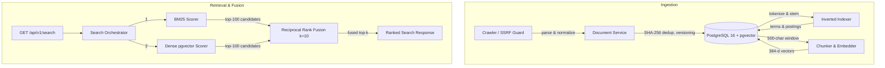

# NEXUS

NEXUS is a hybrid search service built on PostgreSQL. Each project gets its own BM25 inverted index, stored in ordinary SQL tables and scored in Python, alongside `all-MiniLM-L6-v2` chunk embeddings in pgvector. A FastAPI endpoint returns BM25, dense or Reciprocal Rank Fusion (RRF) results. Everything runs on a CPU laptop with no API keys or paid services.

The repository is also a measurement record. Retrieval quality is evaluated on BEIR SciFact with a reproducible harness, and two ideas that did not improve it (a learned query router and cross-encoder reranking) are documented as negative results rather than shipped.

**Implemented here**

- **Ingestion.** Pages come from a crawler (robots.txt, DNS-level SSRF guard) or are saved directly. Documents are versioned per project by URL with a SHA-256 content hash. Changing a document's content de-indexes the old version, so postings, document frequencies and corpus statistics always describe the current text.
- **Lexical search.** Text analysis is NFKC normalization, tokenizing, stopword removal and Snowball stemming. Postings, document frequencies and corpus statistics are scoped per project. Scoring is BM25 with `k1=1.5, b=0.75` and smoothed IDF.
- **Dense search.** Documents are split into 500-character chunks with 100 characters of overlap and embedded in batches. Search is an exact pgvector cosine scan that keeps each document's best chunk.
- **Hybrid search.** RRF merges the top 100 from each branch: `score(d) = Σ 1/(k + rank_i(d))`, with k=10.
- **API.** `GET /api/v1/search` takes `mode=lexical|dense|hybrid_fixed` and returns `score` (higher is better) and `rank`.
- **Evaluation.** NDCG@10, Recall@10/100, MRR and latency on SciFact. Each report records the commit, hardware, library versions and model revisions.

**What the results show** (5,183 SciFact abstracts; full tables [below](#benchmark-results-scifact))

- On 809 queries never used for tuning, hybrid RRF reaches NDCG@10 **0.7180**, against 0.6690 for BM25 and 0.6759 for dense.
- RRF k=10 beats the common default k=60 by only +0.0068 NDCG@10 on those queries, and that difference has not been significance-tested.
- Cross-encoder reranking (`ms-marco-MiniLM-L-6-v2`) *lowered* NDCG@10 from 0.7188 to 0.6752 and made queries about 4.7× slower.

**What they don't show:** behaviour on other domains or corpora much larger than about 5k documents, statistical significance, or latency under concurrent load. Latencies come from one laptop with uncontrolled background load.

---

## Quickstart (8 GB RAM, CPU only)

Prerequisites: Python ≥ 3.12, [uv](https://docs.astral.sh/uv/) and Docker. The first run downloads `all-MiniLM-L6-v2` (~90 MB) from Hugging Face.

```bash
# from the repository root: PostgreSQL 16 + pgvector on host port 5433
docker compose up -d

cd backend
uv sync --all-groups
cp .env.example .env
uv run alembic upgrade head

# Ingest 3 demo documents, run lexical/dense/hybrid searches, keep the project
uv run python -m scripts.dev_smoke --seed
```

Representative output (from a fresh database; IDs will differ):

```
[4/5] Testing Lexical, Dense, and Hybrid (RRF) search...
      [PASS] Lexical search (BM25): Top result 'Robertson-Spärck Jones BM25 Retrieval in NEXUS' (score=2.6056)
      [PASS] Dense search (pgvector): Top result 'Dense Semantic Retrieval with pgvector' (score=0.5274)
      [PASS] Hybrid search (RRF k=10), 'lexical and vector hybrid search':
        1. Reciprocal Rank Fusion (RRF) Hybrid Retrieval  rrf=0.1742  bm25_rank=2  dense_rank=1
        2. Robertson-Spärck Jones BM25 Retrieval in NEXUS  rrf=0.1678  bm25_rank=1  dense_rank=3
        3. Dense Semantic Retrieval with pgvector  rrf=0.0833  bm25_rank=None  dense_rank=2
...
Project ID: 6d09b20a-d65c-4853-947d-82a0be2a6799
```

The hybrid ranking is the fusion arithmetic made visible. The first document is ranked 2nd by BM25 and 1st by dense, so its score is 1/12 + 1/11 = 0.1742. The third document only matched dense retrieval.

Serve the API and query it:

```bash
uv run uvicorn app.main:app --port 8000
curl -G "http://127.0.0.1:8000/api/v1/search" \
  --data-urlencode "project_id=<PROJECT_ID>" --data-urlencode "q=lexical and vector hybrid search"
```

Response (abbreviated):

```json
{"query": "lexical and vector hybrid search", "mode": "hybrid_fixed", "results": [
  {"document_id": "e2c33689-…", "url": "https://nexus.local/docs/reciprocal-rank-fusion",
   "title": "Reciprocal Rank Fusion (RRF) Hybrid Retrieval", "score": 0.1742, "rank": 1,
   "snippet": "Reciprocal Rank Fusion combines ranked candidate lists from lexical BM25 and dense …"},
  …]}
```

On PowerShell: `Invoke-RestMethod "http://127.0.0.1:8000/api/v1/search?project_id=<PROJECT_ID>&q=lexical+and+vector+hybrid+search"`.

- The first dense or hybrid query in a new API process loads the embedding model and takes several seconds.
- A blank `q` returns 422.
- Swagger UI is at `http://127.0.0.1:8000/docs`.
- If port 8000 is taken, use another port and pass the same URL to `scripts.dev_smoke --api-url`.

To search real data, ingest the SciFact corpus with the benchmark harness (see [Verification](#verification)) and query its project ID, which is stored in `backend/.cache/scifact_manifest.json`.

---

## Benchmark results (SciFact)

Corpus: the 5,183 scientific abstracts of [SciFact](https://github.com/allenai/scifact) as distributed by [BEIR](https://github.com/beir-cellar/beir). Two query sets play different roles:

- **Tuning split, 300 queries.** These are BEIR's SciFact "test" qrels, which are the official SciFact **dev** claims (identical IDs and text). The RRF constant k=10 was chosen on this split, so its k=10 row is a tuned result.
- **Untuned split, 809 queries.** These are BEIR's SciFact "train" qrels, the official SciFact train claims. No NEXUS parameter was selected on them, so this is the out-of-sample check.

Official SciFact test labels are not public and are not used.

**Untuned split (809 queries)**:

| Retriever / Fusion | Configuration | NDCG@10 | Recall@10 | Recall@100 | MRR | Latency Avg | Latency P95 |
|---|---|---:|---:|---:|---:|---:|---:|
| Lexical only | Custom BM25 (`k1=1.5, b=0.75`) | 0.6690 | 0.7886 | 0.9149 | 0.6413 | 85 ms | 188 ms |
| Dense only | `all-MiniLM-L6-v2` + pgvector exact cosine | 0.6759 | 0.8042 | 0.9306 | 0.6503 | 120 ms | 210 ms |
| Hybrid RRF | k=60 (Cormack et al. default), depth 100/100 | 0.7112 | 0.8312 | 0.9522 | 0.6835 | 204 ms | 355 ms |
| **Hybrid RRF (default)** | **k=10, depth 100/100** | **0.7180** | **0.8422** | **0.9522** | **0.6888** | **208 ms** | **366 ms** |

**Tuning split (300 queries; k=10 selected here)**:

| Retriever / Fusion | NDCG@10 | Recall@10 | Recall@100 | MRR | Latency Avg | Latency P95 |
|---|---:|---:|---:|---:|---:|---:|
| Lexical only (BM25) | 0.6736 | 0.8105 | 0.9064 | 0.6388 | 90 ms | 172 ms |
| Dense only | 0.6642 | 0.8096 | 0.9277 | 0.6287 | 143 ms | 233 ms |
| Hybrid RRF, k=60 | 0.7043 | 0.8249 | 0.9577 | 0.6783 | 230 ms | 369 ms |
| **Hybrid RRF, k=10 (default)** | **0.7188** | **0.8568** | **0.9577** | **0.6850** | 272 ms | 557 ms |
| k=10 + cross-encoder rerank of top 25 | 0.6752 | 0.8240 | n/a | 0.6386 | 1,273 ms | 1,871 ms |

The generated reports record model revisions, library versions and hardware: [`backend/docs/benchmark-evaluation-train.md`](backend/docs/benchmark-evaluation-train.md) and [`backend/docs/benchmark-evaluation-test.md`](backend/docs/benchmark-evaluation-test.md), each with a `.json` sidecar.

- **Reproducibility.** On a freshly rebuilt index, the tuning-split quality metrics for BM25, dense and hybrid reproduced the previously published values exactly. Reranking came out at 0.6752 vs 0.6751.
- **Latency.** It was measured on an Intel i5-10200H laptop (8 GB RAM, CPU only) **while other workloads competed for memory**, so treat it as indicative. The k=10 and k=60 hybrid rows do identical work, so their latency differences are measurement noise.

### Findings

1. **Fusion helps, out of sample too.** On the untuned split, hybrid RRF (k=10) improves NDCG@10 by +0.049 (+7.3%) over BM25 and +0.042 (+6.2%) over dense, and lifts Recall@100 to 0.952. Neither single retriever dominates: BM25 wins on the tuning split, dense on the untuned one.
2. **k=10 beats k=60, but by less than the tuning split suggested.** The gain is +0.0145 NDCG@10 on the split where k was chosen and +0.0068 on the untuned split. Per-query significance has not been tested, so treat k=10 as a small, corpus-specific improvement rather than a general rule.
3. **Latency cost.** Hybrid runs both retrievers one after the other, because they share a database session. That roughly doubles average latency relative to either single retriever on this machine: 85–120 ms rises to about 208 ms on the untuned split.

---

## Experiments that did not ship

### 1. Learned query router: rejected ([ADR-004](docs/adr/004-learned-router-rejection.md))
- **Hypothesis**: A decision tree over 8 query features could route keyword-heavy queries to BM25 only, halving latency without hurting quality.
- **Evaluation**: 6 retrieval configurations × 300 queries (the tuning split above), with 5-fold GroupKFold by query.
- **Outcome**: Mean latency fell from ~158 ms to ~81 ms, but NDCG@10 dropped from 0.7188 to 0.6742. 19.7% of queries lost more than 0.05 NDCG@10, and the worst query fell from 1.0 to 0.0. For example, *"The one-child policy has been successful in lowering population growth."* was routed to BM25 only, while its evidence paraphrases the claim with no shared vocabulary. Details are in [`backend/docs/routing-evaluation.md`](backend/docs/routing-evaluation.md).
- **Decision**: Rejected. The router remains available only as `experimental_learned`.

### 2. Cross-encoder reranking: rejected ([ADR-005](docs/adr/005-cross-encoder-rejection.md))
- **Hypothesis**: Reranking fused candidates with `cross-encoder/ms-marco-MiniLM-L-6-v2` improves ranking.
- **Outcome**: Re-measured in this release at depth 25 on the tuning split, NDCG@10 was **0.6752** vs 0.7188 without reranking, at ~4.7× the average latency. The original study found NDCG@10 falling at depths 10, 25 and 50 alike.
- **Decision**: Rejected for the default path; available as `experimental_hybrid_rerank`.

### 3. LLM query expansion: inconclusive
- 1,103 of 1,109 queries failed with HTTP 429 quota errors on a free-tier endpoint, so no quality claim is made. See [`docs/llm-query-transformation-evaluation.md`](docs/llm-query-transformation-evaluation.md).

---

## Architecture



**Data flow.**
- `save_document()` stores a document version per project and URL. Identical content is a no-op (SHA-256 hash). Changed content creates a new version and de-indexes the old one.
- The indexer writes per-project postings with token counts. Positions are stored and used only to choose snippets.
- `process_pending_chunks()` embeds chunks in batches.
- At query time, BM25 and dense retrieval run in turn on the request's database session, and RRF fuses their ranked lists.
- A failure in either branch propagates as an error rather than being returned as a hybrid result.

**Tenant isolation.** `documents` is unique on `(project_id, canonical_url)` and `search_terms` on `(project_id, term)`, and corpus statistics are kept per project. No document, term or BM25 statistic is shared across projects ([ADR-006](docs/adr/006-project-scoped-isolation.md)).

More detail: [`docs/architecture.md`](docs/architecture.md), [`docs/adr/`](docs/adr/).

### What is built here vs delegated

| Layer | Implemented in this repository | Delegated |
|---|---|---|
| Text analysis | NFKC normalization, tokenizer, 174-word stopword list, stemming pipeline ([`analyzer.py`](backend/app/domains/search/analyzer.py)) | NLTK Snowball stemmer |
| Lexical index & BM25 | Relational inverted index, per-project statistics, smoothed-IDF BM25 (`k1=1.5, b=0.75`), version-aware (de)indexing ([`indexer.py`](backend/app/domains/search/indexer.py), [`bm25.py`](backend/app/domains/search/bm25.py)) | PostgreSQL |
| Dense search | Sliding-window chunking, best-chunk-per-document aggregation ([`search.py`](backend/app/domains/embeddings/search.py)) | `sentence-transformers`, pgvector `<=>` |
| Fusion | RRF and multi-query RRF ([`fusion.py`](backend/app/domains/search/retrieval/fusion.py)) | — |
| Crawler security | BFS frontier, robots.txt, DNS-level SSRF guard ([`ssrf.py`](backend/app/domains/crawler/ssrf.py)) | BeautifulSoup4, HTTPX |
| Evaluation | NDCG/Recall/Precision/MRR/Jaccard, latency percentiles, pre-flight corpus checks ([`metrics.py`](backend/scripts/benchmark/metrics.py)) | BEIR's SciFact distribution |

---

## Verification

### Fast checks (no database, no model downloads; what CI's `quality` job runs)

```bash
cd backend
uv run ruff check . && uv run ruff format --check . && uv run mypy .
uv run python -m scripts.benchmark verify   # IR metric, RRF and analyzer invariants
uv run pytest tests/                         # integration tests skip without Postgres
```

`verify` checks the maths in well under a second; most of its few-second wall time is spent importing NLTK.

### Integration tests (Postgres running; CI's `integration` job)

With Postgres up, `uv run pytest tests/` runs all 60 tests.

- **Isolation.** Integration tests use a separate database, `<POSTGRES_DB>_test`, which is created automatically and truncated between tests. The development database and its benchmark index are never touched.
- **Coverage.** Tenant isolation, version replacement, idempotent re-ingestion, empty and no-match queries, ranking order and uniqueness per mode, hybrid fusion on a fresh session, failure propagation, API validation and the crawler pipeline.
- **CI extras.** CI also applies migrations to a fresh database and runs `scripts.dev_smoke`.

### Full evaluation (optional: ~15 min ingestion, then ~5–15 min per split on a laptop CPU)

```bash
cd backend
uv run python -m scripts.benchmark prepare --dataset scifact    # downloads BEIR SciFact, ingests, embeds
uv run python -m scripts.benchmark evaluate --dataset scifact --split train
uv run python -m scripts.benchmark evaluate --dataset scifact --split test [--with-rerank]
```

`prepare` refuses to trust a manifest whose project is missing or incomplete, and re-ingests instead. With the same model revisions, quality metrics should match the committed reports to four decimals; latency will not. Methodology: [`docs/benchmarking.md`](docs/benchmarking.md).

---

## Hardware & cost

- Developed and measured on a 4-core/8-thread laptop CPU with 8 GB RAM. No GPU is needed.
- Runtime models are downloaded from Hugging Face on first use: `all-MiniLM-L6-v2` (~90 MB, embeddings) and, only for the experimental rerank mode, `ms-marco-MiniLM-L-6-v2`.
- On Linux, `uv sync` installs the default PyPI `torch` wheel, which pulls large CUDA libraries even though NEXUS only uses the CPU. This costs download size and disk space, not RAM.
- The core workflow needs no API keys. `OPENAI_*` settings are only for the inconclusive `experimental_multi_query_llm` mode.

## Known limitations

1. **Exact dense scan.** pgvector computes exact cosine distance with no HNSW or IVFFlat index. That's fine at 5k documents, but cost grows linearly with corpus size.
2. **Single benchmark.** Quality is measured on one scientific-abstract corpus, and k=10 was tuned on part of it.
3. **Noisy latency.** Latency numbers come from a single machine (see above). No load or concurrency testing has been done.
4. **Blocking embedding.** Query embedding runs synchronously inside the async request handler, so concurrent API requests wait for each other's embedding step.
5. **No authentication.** Project isolation is enforced in the data layer, but any API caller can query any project.
6. **Character-based chunking.** Chunks of 500 characters with 100 characters of overlap ignore sentence boundaries.
7. **Inline processing.** Indexing and embedding run in-process; there is no task queue.
8. **Startup cost.** Importing the app takes a few seconds, mostly NLTK pulling in SciPy and scikit-learn.

Full list: [`docs/limitations.md`](docs/limitations.md).

---

## Repository map

```
NEXUS/
├── docker-compose.yml        # PostgreSQL 16 + pgvector (host port 5433)
├── docs/                     # architecture, benchmarking methodology, limitations, ADRs 001–006
└── backend/
    ├── app/                  # FastAPI app: api/v1 routes and domains (crawler, documents,
    │                         #   embeddings, projects, search/{query,retrieval})
    ├── alembic/              # schema migrations
    ├── scripts/benchmark/    # SciFact harness (prepare, evaluate, verify)
    ├── scripts/dev_smoke.py  # end-to-end smoke test and demo seeder
    ├── scripts/router_training/
    ├── docs/                 # generated benchmark reports and experiment write-ups
    └── tests/                # unit, invariant and Postgres integration tests
```

## Next steps

1. **HNSW indexing**: measure build time, latency and recall for pgvector HNSW (`m`, `ef_construction`, `ef_search`).
2. **Significance testing**: store per-query metrics and add paired tests for configuration comparisons such as k=10 vs k=60.
3. **Sentence-aware chunking**: test whether sentence-boundary chunks improve dense retrieval on SciFact.
