# NEXUS

> **Technical Thesis**: NEXUS is an experimental retrieval engine designed to investigate when combining lexical and dense retrieval justifies its added complexity. Design decisions are governed by empirical rank quality, regret analysis, and latency cost rather than infrastructure fashion: implementation → measurement → failure → decision.

```
Web Ingestion / Crawler ──► Document Normalization ──► PostgreSQL 16 (Unified Store)
                                                         ├── Inverted Index ──► Positional BM25 ──┐
                                                         └── Chunk Embeddings ─► pgvector Cosine ─┤
                                                                                                  ▼
FastAPI (/api/v1/search) ◄── Top-K Ranked Results ◄── Reciprocal Rank Fusion (RRF, k=10) ◄───────┘
```

---

## Benchmark Evidence (SciFact, 300-Query Test Split)

Evaluated against 5,183 scientific research abstracts and the canonical 300-query test split from the [SciFact](https://github.com/allenai/scifact) benchmark (Allen Institute for AI):

| Retriever / Fusion Mode | Configuration | NDCG@10 | Recall@100 | Latency P95 | Latency Avg |
|---|---|---:|---:|---:|---:|
| Lexical Only | Custom BM25 (`k1=1.5, b=0.75`) | 0.6736 | 0.9064 | 192.81 ms | 97.82 ms |
| Dense Only | `all-MiniLM-L6-v2` + pgvector cosine | 0.6642 | 0.9277 | 212.57 ms | 133.34 ms |
| Hybrid RRF (Cormack Heuristic) | RRF (`k=60`, depth 100/100) | 0.7043 | 0.9577 | 282.16 ms | 175.33 ms |
| Hybrid RRF (Intermediate) | RRF (`k=30`, depth 100/100) | 0.7137 | 0.9577 | 308.01 ms | 201.52 ms |
| **Hybrid RRF (Production Baseline)** | **RRF (`k=10`, depth 100/100)** | **0.7188** | **0.9577** | **313.14 ms** | **201.13 ms** |

### Key Empirical Findings:
1. **Complementary Strengths**: BM25 excels on exact scientific terms and identifiers; dense retrieval recovers semantically paraphrased claims. Combining both via RRF yields a **+6.7% NDCG@10 gain** over BM25-only and **+8.2%** over Dense-only, driving Recall@100 to 95.77%.
2. **The RRF k-Parameter Sweep**: Cormack et al. originally proposed $k=60$ for ad-hoc web search. On the evaluated SciFact test split, sweeping $k \in \{10, 30, 60\}$ revealed that $k=10$ provides sharper rank damping, increasing weight for top-rank cross-retriever agreements and producing a **+0.0145 NDCG@10 improvement** over $k=60$. This $k=10$ configuration is an empirical result on this specific short-abstract technical corpus rather than a universally optimal parameter across arbitrary document collections.
3. **Latency Trade-off**: Hybrid retrieval executes lexical and dense paths concurrently via `asyncio.create_task`, incurring ~100ms P95 overhead over single-branch retrieval.

---

## Codebase Inspection Path

For engineers evaluating architecture and implementation depth directly from source:

```
1. Verify Invariants (0.2s)    ──► python -m scripts.benchmark verify (validates IR math & RRF)
2. Core Retrieval Logic        ──► backend/app/domains/search/bm25.py (Robertson-Spärck Jones BM25)
3. Rank Fusion Implementation  ──► backend/app/domains/search/retrieval/fusion.py (RRF algorithm)
4. Mathematical Invariants     ──► backend/tests/search/test_invariants.py (monotonicity & bounds)
5. Tenant Isolation Contract   ──► backend/tests/benchmark/test_isolation.py (multi-tenant boundaries)
6. Negative-Result Regret      ──► backend/docs/routing-evaluation.md (learned router failure analysis)
7. Architectural Decisions     ──► docs/adr/ (6 ADRs: storage, BM25, RRF, router & reranker rejections)
```

---

## What I Built vs What Is Delegated

| Layer | Custom Implementation (Built from Scratch in Repo) | Delegated Library / Framework |
|---|---|---|
| **Text Analysis** | Unicode NFKC normalizer, tokenizer (`\b[\w'-]+\b`), 174-stopword filter, Snowball stemmer pipeline ([`analyzer.py`](backend/app/domains/search/analyzer.py)) | NLTK Snowball stemmer core |
| **Lexical Indexing** | Relational inverted index schema (`search_terms`, `search_postings`), document length statistics (`DocumentStats`, `ProjectStats`), positional term arrays ([`indexer.py`](backend/app/domains/search/indexer.py)) | PostgreSQL relational engine |
| **BM25 Scoring** | Probabilistic Robertson-Spärck Jones formula, document length normalization ($b=0.75$), frequency saturation ($k_1=1.5$), non-negative smoothed IDF, positional snippet extraction ([`bm25.py`](backend/app/domains/search/bm25.py)) | None (pure Python / SQLAlchemy) |
| **Dense Search** | Chunking (500-char sliding window, 100-char overlap), best-chunk-per-document deduplication, embedding join queries ([`search.py`](backend/app/domains/embeddings/search.py)) | `sentence-transformers` (`all-MiniLM-L6-v2`), pgvector `<=>` cosine operator |
| **Rank Fusion** | Reciprocal Rank Fusion with configurable $k$, candidate union mapping, rank assignment ([`fusion.py`](backend/app/domains/search/retrieval/fusion.py)) | None (pure Python) |
| **Multi-Tenancy** | Composite database constraints `(project_id, canonical_url)` and `(project_id, term)`, tenant-scoped posting lists and corpus statistics | PostgreSQL unique constraints |
| **Crawler Security** | BFS crawl frontier, robots.txt compliance, DNS-level SSRF guard blocking loopback, private, link-local, and multicast IP ranges ([`ssrf.py`](backend/app/domains/crawler/ssrf.py)) | BeautifulSoup4, HTTPX |
| **Evaluation Suite** | Metric implementations: NDCG@k, Recall@k, Precision@k, MRR, Jaccard@k, latency percentiles ([`metrics.py`](backend/scripts/benchmark/metrics.py)), pre-flight corpus assertions | HuggingFace datasets (SciFact download) |

---

## Why The Problem Is Difficult

Most search prototypes delegate indexing and retrieval to hosted services (Pinecone, Elasticsearch) and combine results via arbitrary score weights. This obscures foundational retrieval problems:

1. **Score Incommensurability**: Cosine distance $\in [0, 2]$ and BM25 scores $\in [0, \infty)$ cannot be linearly summed without corpus-dependent calibration. Reciprocal Rank Fusion operates strictly on ranks, eliminating score calibration errors.
2. **Length Normalization Edge Cases**: Without smoothed IDF, high-frequency terms appearing in every document can produce negative weights in standard Robertson-Spärck Jones formulations. NEXUS uses the $+1.0$ smoothed formulation:
   $$\text{IDF}(t) = \ln\left(\frac{N - n(t) + 0.5}{n(t) + 0.5} + 1.0\right)$$
   guaranteeing $\text{IDF}(t) > 0$ for all $n(t) \le N$, protected by automated invariant tests.
3. **Semantic Drift vs Exact Match**: Dense retrieval often hallucinates topical relevance on scientifically negated statements (e.g. claiming a vitamin *prevents* vs *does not prevent* disease), whereas BM25 preserves lexical precision.
4. **Tenant Data Leakage**: In multi-tenant retrieval, shared URLs across projects must never share document records or leak inverted index terms.

---

## Architecture

```mermaid
flowchart TD
    subgraph Ingestion["Ingestion Subsystem"]
        CR[Crawler / SSRF Guard] -->|parse & normalize| DS[Document Service]
        DS -->|SHA-256 dedup| PG[(PostgreSQL 16 + pgvector)]
        PG -->|tokenize & stem| IDX[Inverted Indexer]
        PG -->|500-char window| CHK[Chunker & Embedder]
        IDX -->|terms & postings| PG
        CHK -->|384-d vectors| PG
    end

    subgraph Retrieval["Retrieval & Fusion Subsystem"]
        REQ[Search Request /api/v1/search] --> ORCH[Search Orchestrator]
        ORCH -->|async task 1| LEX[BM25 Scorer]
        ORCH -->|async task 2| DNS[Dense pgvector Scorer]
        LEX -->|top-100 candidates| RRF[Reciprocal Rank Fusion k=10]
        DNS -->|top-100 candidates| RRF
        RRF -->|fused top-k| RESP[Ranked Search Response]
    end

    style PG fill:#1e293b,stroke:#3b82f6,color:#f8fafc
    style RRF fill:#312e81,stroke:#818cf8,color:#f8fafc
    style ORCH fill:#1e1e38,stroke:#a855f7,color:#f8fafc
```



### Relational Schema & Tenant Isolation Invariants
- `documents`: `UniqueConstraint('project_id', 'canonical_url')` — identical URLs across distinct tenants receive independent UUIDs and never share state.
- `search_terms`: `UniqueConstraint('project_id', 'term')` — lexical vocabularies are completely partitioned per tenant.
- `search_project_stats`: `total_documents` and `total_tokens` are per-project, preventing cross-tenant document length distortion in BM25 normalization.

---

## Negative Results: Engineering by Measurement

Architecture governed by empirical measurement requires documenting and evaluating discarded design paths alongside successful baselines.

### 1. Learned Query Router — REJECTED (ADR-004)
- **Hypothesis**: A decision tree trained on 8 query features (token count, identifier density, quoted ratio, term rarity, natural language score, etc.) could dynamically route queries to BM25-only to save 50% latency without degrading ranking quality.
- **Evaluation**: 5-fold GroupKFold cross-validation (grouped by `query_id` to prevent data leakage) across 1,109 queries and 6 retrieval configurations.
- **Outcome**:

| Metric | Fixed Hybrid Baseline | Decision Tree Router | Delta |
|---|---:|---:|---:|
| **NDCG@10** | 0.7188 | 0.6742 | −0.0446 (−6.2%) |
| **Mean Latency** | ~157.8 ms | ~80.7 ms | −48.8% |
| **Queries Degraded > 0.05 NDCG** | 0.0% | **19.7%** | +19.7% of queries harmed |
| **Worst-Case Regret** | 0.0 | **−1.0000** | Catastrophic failure |

- **Catastrophic Failure Inspection**:
  - *Query*: `"The one-child policy has been successful in lowering population growth."`
  - *Fixed Hybrid NDCG*: `1.0000` | *Router NDCG*: `0.0000` ($\Delta = -1.0$)
  - *Root Cause*: The query lacked rare tokens, leading the tree to route to BM25-only (Config D). However, the evidence documents in SciFact used semantic paraphrases with non-overlapping vocabulary. BM25 retrieved 0 relevant documents, causing complete retrieval failure.
- **Decision**: **Rejected**. A 49% latency reduction cannot justify a 19.7% query degradation rate and catastrophic tail failure.

### 2. Cross-Encoder Reranking — REJECTED (ADR-005)
- **Hypothesis**: Reranking top-k RRF candidates with a pretrained cross-encoder (`ms-marco-MiniLM-L-6-v2`) would improve ranking accuracy.
- **Evaluation**: Reranking applied at candidate depths 10, 25, and 50 on SciFact.
- **Outcome**:

| Reranking Depth | NDCG@10 | P95 Latency | Latency Multiplier |
|---|---:|---:|---:|
| **Baseline (No Rerank)** | **0.7188** | **313.14 ms** | **1.0×** |
| Top 10 Candidates | 0.6858 | 608.76 ms | 1.94× |
| Top 25 Candidates | 0.6751 | 1,475.43 ms | 4.71× |
| Top 50 Candidates | 0.6691 | 3,288.34 ms | 10.50× |

- **Decision**: **Rejected**. On this corpus and chunk size (500 chars), the cross-encoder *reduced* NDCG@10 at every depth while inflating tail latency by up to 10×. The already-fused RRF ranking was higher quality than the lightweight cross-encoder's passage scores.

### 3. LLM Query Expansion — INCONCLUSIVE (Infrastructure Limit)
- **Hypothesis**: LLM-generated variants with semantic drift filtering could boost multi-query recall.
- **Outcome**: 1,103 / 1,109 queries (99.5%) failed due to HTTP 429 quota exhaustion on free-tier endpoints. Documented transparently in [`docs/llm-query-transformation-evaluation.md`](docs/llm-query-transformation-evaluation.md). No unverified claims are made.

---

## Architectural Decision Records (ADRs)

| ADR | Decision | Core Evidence | Status |
|---|---|---|---|
| [**001**](docs/adr/001-postgresql-pgvector.md) | Single PostgreSQL 16 + pgvector store | Eliminates multi-store synchronization; exact scan achieves 212ms P95 on SciFact | Accepted |
| [**002**](docs/adr/002-custom-bm25-inverted-index.md) | Custom Inverted Index + Robertson-Spärck Jones BM25 | Full control of parameters ($k_1=1.5, b=0.75$), positional snippets, zero external cluster overhead | Accepted |
| [**003**](docs/adr/003-reciprocal-rank-fusion.md) | Reciprocal Rank Fusion ($k=10$ production baseline) | Empirical $k$-sweep ($k=10$ vs $k=60$) yielded +0.0145 NDCG@10 lift over standard heuristic | Accepted |
| [**004**](docs/adr/004-learned-router-rejection.md) | Reject Learned Query Router | 19.7% query degradation rate and $-1.0$ worst-case regret outweighed 49% latency savings | Rejected |
| [**005**](docs/adr/005-cross-encoder-rejection.md) | Reject Cross-Encoder Reranking | NDCG dropped at all depths while P95 latency increased by $2\times$ to $10\times$ | Rejected |
| [**006**](docs/adr/006-project-scoped-isolation.md) | Composite unique constraints for project isolation | `(project_id, canonical_url)` enforced at DB engine level; 5 dedicated isolation tests pass | Accepted |

---

## Reproducibility & Verification

### 1. Instant Hermetic Verification (< 0.2s — No Docker or DB Required)

Verifies all IR mathematical invariants, metric algorithms, and RRF calculations offline:

```bash
cd backend
uv run python -m scripts.benchmark verify
```

Expected output:
```
======================================================================
NEXUS Retrieval Engine & Evaluation Harness Verification
======================================================================
 [PASS] NDCG@k and Graded DCG mathematical correctness
 [PASS] Precision@k and Recall@k threshold calculations
 [PASS] MRR (Mean Reciprocal Rank) and Jaccard set overlap
 [PASS] Reciprocal Rank Fusion (RRF) formula & k=10 vs k=60 parameter invariant
 [PASS] Text Analyzer normalization, 174-stopword filtering, Snowball stemming
----------------------------------------------------------------------
All IR mathematics, fusion invariants, and metric suites verified.
Status: 100% PASS (5/5 invariants)
======================================================================
```

### 2. Static Analysis & Test Suite

```bash
cd backend

# Static analysis across all 80 source files (0 errors, 100% clean)
uv run ruff check .
uv run mypy .

# Run test suite (38 hermetic unit & invariant tests pass instantly)
uv run pytest tests/ -v
```

### 3. Full Benchmark Execution (Requires Docker)

```bash
# 1. Start PostgreSQL + pgvector
docker compose up -d

# 2. Run migrations
cd backend
uv run alembic upgrade head

# 3. Prepare SciFact corpus (ingests 5,183 abstracts, builds inverted index & embeddings)
uv run python -m scripts.benchmark prepare --dataset scifact

# 4. Evaluate canonical 300-query test split
uv run python -m scripts.benchmark evaluate --dataset scifact --split test
```

---

## Repository Map

```
NEXUS/
├── README.md                                 # System thesis, empirical evidence, and architecture
├── docker-compose.yml                        # PostgreSQL 16 + pgvector container definition
├── docs/                                     # System documentation
│   ├── adr/                                  # 6 Architectural Decision Records (001 - 006)
│   ├── architecture.md                       # Subsystem specifications, ER diagrams, data flow
│   ├── benchmarking.md                       # Protocol, metric definitions, and reproducibility
│   ├── engineering-walkthrough.md            # Chronological evolution from prototype to hardened IR
│   └── limitations.md                        # Explicit operational boundaries and non-claims
└── backend/
    ├── pyproject.toml                        # Build configuration, Ruff & Mypy baselines
    ├── alembic/                              # 5 database migrations (schema evolution)
    ├── app/
    │   ├── api/v1/                           # FastAPI route handlers (/search, /crawl, /projects)
    │   ├── config/settings.py                # Pydantic settings with environment validation
    │   └── domains/
    │       ├── crawler/                      # BFS crawl frontier, HTML parsing, SSRF guard
    │       ├── documents/                    # Content-hash deduplication, versioning, storage
    │       ├── embeddings/                   # Sliding-window chunker, pgvector search, provider
    │       ├── projects/                     # Multi-tenant project service and models
    │       └── search/
    │           ├── analyzer.py               # NFKC normalization, stopwords, Snowball stemming
    │           ├── bm25.py                   # Robertson-Spärck Jones BM25 implementation
    │           ├── indexer.py                # Inverted index term upsert and posting lists
    │           ├── retrieval/                # Orchestrator, RRF fusion, reranker, learned router
    │           └── query/                    # Query feature extraction and classification
    ├── scripts/
    │   ├── benchmark/                        # SciFact harness, dataset loader, metrics, verify
    │   └── router_training/                  # Action-outcome matrix, decision tree training & eval
    └── tests/
        ├── benchmark/                        # Fusion math, metric suites, project isolation
        ├── crawler/                          # SSRF validation, normalizer, HTML parsing
        └── search/                           # BM25 invariants, analyzer determinism, integration
```

---

## Known Limitations

1. **Dense Retrieval Uses Exact Scan**: pgvector queries currently compute exact cosine distance (`<=>`). On 5,183 documents this takes ~200ms P95, but scaling beyond 50,000 documents requires building an HNSW index (`CREATE INDEX ON chunk_embeddings USING hnsw (embedding vector_cosine_ops)`).
2. **Fixed Chunking Strategy**: Chunks use a fixed 500-character window with 100-character overlap without syntactic sentence boundary detection.
3. **No Distributed Workers**: Document indexing and embedding generation execute inline via async database sessions rather than through an external task queue (Celery/RabbitMQ).
4. **Single-Domain Crawling**: The crawler enforces strict source domain boundaries and does not execute client-side JavaScript.
5. **No Public Auth**: The API relies on database-level `project_id` scoping; it does not implement JWT/OAuth authentication.

---

## What I Would Build Next

1. **pgvector HNSW Indexing**: Implement and measure HNSW index parameters (`m=16, ef_construction=64`) to evaluate the index build time vs latency vs recall trade-off.
2. **Sentence-Aware Chunker**: Replace fixed character window with SpaCy/NLTK sentence boundary chunking to evaluate if semantic chunk boundaries improve Dense retrieval NDCG.
3. **ColBERT / Late Interaction**: Evaluate late-interaction token embeddings (ColBERT/PLAID) to bridge the gap between bi-encoder speed and cross-encoder accuracy without the $10\times$ latency penalty.
