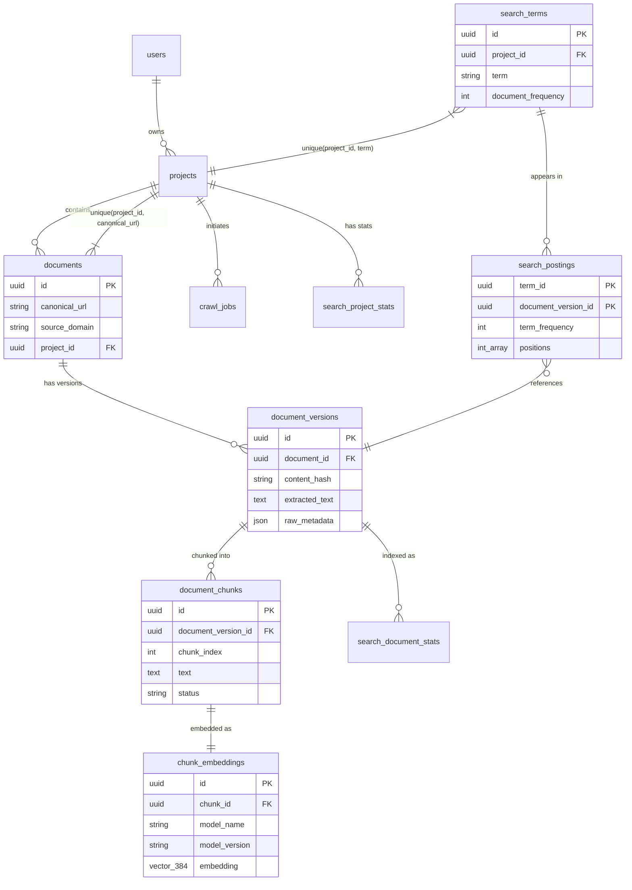

# Architecture

## System overview

NEXUS is a hybrid search engine with three major subsystems: **ingestion**, **retrieval**, and **evaluation**. All subsystems share a single PostgreSQL database (with pgvector) as the storage layer.

```
┌─────────────────────────────────────────────────────────┐
│                     FastAPI (app/main.py)                │
│  /api/v1/projects  /api/v1/crawl  /api/v1/search       │
└─────────────┬───────────────┬───────────────┬───────────┘
              │               │               │
     Project CRUD      Crawl Jobs      Search Orchestrator
              │               │               │
              └───────┬───────┘               │
                      │                       │
              ┌───────▼───────┐       ┌───────▼───────┐
              │   Ingestion   │       │   Retrieval   │
              │               │       │               │
              │  Crawler      │       │  BM25         │
              │  Parser       │       │  Dense        │
              │  Normalizer   │       │  RRF Fusion   │
              │  Doc Service  │       │  Orchestrator │
              │  Indexer      │       │               │
              │  Chunker      │       │  (Experimental│
              │  Embedder     │       │   Router      │
              │               │       │   Reranker    │
              └───────┬───────┘       │   LLM Query)  │
                      │               └───────┬───────┘
                      │                       │
              ┌───────▼───────────────────────▼───────┐
              │           PostgreSQL + pgvector        │
              │                                        │
              │  documents / document_versions          │
              │  search_terms / search_postings          │
              │  search_project_stats / search_doc_stats  │
              │  document_chunks / chunk_embeddings       │
              │  projects / users                         │
              │  crawl_jobs / crawl_targets               │
              │  benchmark_mappings                       │
              └────────────────────────────────────────┘
```

## Component responsibilities

### Ingestion pipeline

| Component | File | Responsibility |
|---|---|---|
| Crawler Service | `crawler/service.py` | BFS crawl with domain-scoped frontier, concurrency semaphore, robots.txt respect |
| Fetcher | `crawler/fetcher.py` | HTTP client with SSRF validation, redirect handling, content-type filtering |
| Parser | `crawler/parser.py` | BeautifulSoup HTML→text extraction, link discovery, metadata extraction |
| URL Normalizer | `crawler/normalizer.py` | Canonical URL normalization (lowercase, port stripping, fragment removal) |
| SSRF Guard | `crawler/ssrf.py` | Blocks private/loopback/link-local IPs via DNS resolution check |
| Document Service | `documents/service.py` | Project-scoped deduplication via content hash, versioning, triggers indexing + embedding |
| Indexer | `search/indexer.py` | Text analysis → term upsert → posting list creation → project stats update |
| Chunker | `embeddings/chunker.py` | 500-char sliding window with 100-char overlap |
| Embedding Pipeline | `embeddings/pipeline.py` | Batch embedding with `all-MiniLM-L6-v2`, status tracking (PENDING → EMBEDDED / FAILED) |

### Retrieval pipeline

| Component | File | Responsibility |
|---|---|---|
| Text Analyzer | `search/analyzer.py` | NFKC → lowercase → tokenize → stopword removal → Snowball stemming |
| BM25 Scorer | `search/bm25.py` | Full BM25 scoring with positional snippet extraction |
| Dense Search | `embeddings/search.py` | pgvector cosine distance, best-chunk-per-document deduplication |
| RRF Fusion | `retrieval/fusion.py` | Standard RRF and multi-query RRF (Strategy A / B) |
| Orchestrator | `retrieval/orchestrator.py` | Parallel dispatch, mode routing, fallback handling |
| Reranker | `retrieval/reranker.py` | Cross-encoder reranking (lazy-loaded, experimentally rejected) |
| Learned Router | `retrieval/learned_router.py` | Decision tree routing (experimentally rejected) |
| Query Features | `query/features.py` | 8 query features: token count, rarity, NL score, identifier density, etc. |
| Query Classifier | `query/classifier.py` | Rule-based classification: IDENTIFIER_HEAVY, NATURAL_LANGUAGE_QUESTION, TECHNICAL |
| Query Planner | `query/planner.py` | Maps classifications to retrieval depth configurations |

### Evaluation

| Component | File | Responsibility |
|---|---|---|
| Benchmark Harness | `scripts/benchmark/__main__.py` | Dataset preparation, corpus ingestion, experiment execution |
| SciFact Dataset | `scripts/benchmark/datasets/scifact.py` | Downloads and parses SciFact corpus + qrels |
| Metrics | `scripts/benchmark/metrics.py` | NDCG@k, Recall@k, Precision@k, MRR, Jaccard@k |
| Experiment Tracker | `scripts/benchmark/experiment.py` | Aggregates per-query metrics and latency percentiles |
| Router Training | `scripts/router_training/train.py` | Oracle labeling, decision tree / random forest training |
| Router Evaluation | `scripts/router_training/evaluate.py` | GroupKFold validation, regret analysis, worst-case inspection |

## Database model



### Key constraints

- **Document uniqueness**: `UniqueConstraint('project_id', 'canonical_url')` — the same URL can exist in different projects but not duplicated within a project.
- **Term scoping**: `UniqueConstraint('project_id', 'term')` — the inverted index is strictly partitioned by project.
- **Content deduplication**: Document versions are deduplicated by SHA-256 content hash within the same document.

## Retrieval flow (hybrid mode)

```
1. API receives query + project_id + mode
2. SearchMode.normalize_mode() maps mode string to internal mode
3. Orchestrator dispatches based on mode:
   
   hybrid_fixed:
     ├── asyncio.create_task(retrieve_lexical)  →  BM25 candidates
     └── asyncio.create_task(retrieve_dense)    →  Dense candidates
     
4. BM25 path:
   query → analyze_text() → term lookup → posting retrieval → BM25 score → rank
   
5. Dense path:
   query → embed_query() → pgvector cosine_distance → best chunk per doc → rank
   
6. reciprocal_rank_fusion(bm25_candidates, dense_candidates, k=60)
   → Union map by document_id
   → RRF score = Σ 1/(k + rank_i)
   → Sort descending
   → Assign final ranks
   
7. Return top_k candidates as SearchResponse
```

### Failure handling

The orchestrator implements explicit fallback:
- If BM25 fails in hybrid mode: continues with dense results only
- If Dense fails in hybrid mode: continues with BM25 results only
- If RRF fusion fails: returns the available candidate list directly
- If adaptive/learned planning fails: falls back to `hybrid_fixed`
- If reranker fails: returns un-reranked fusion results

## Isolation model

Every data access path filters by `project_id`:

1. **Document storage**: `Document.project_id` with unique constraint on `(project_id, canonical_url)`
2. **BM25 retrieval**: `ProjectStats` and `Term` are queried with `WHERE project_id = ?`
3. **Dense retrieval**: `Document.project_id == project_id` in the embedding join query
4. **Index statistics**: `ProjectStats.project_id` — corpus size and avgdl are per-project

This means two projects can ingest the same URL independently, and searching one project never returns documents from another. This is verified by dedicated integration tests.
